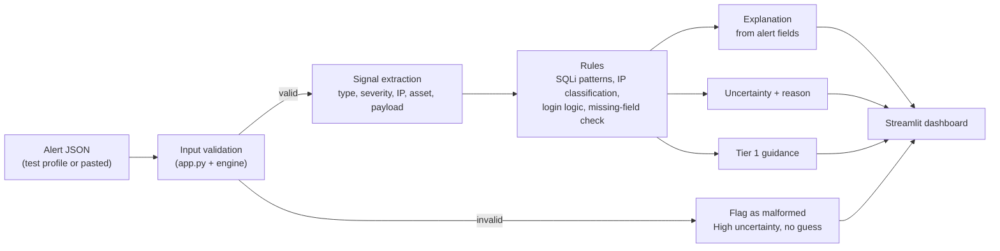

# Explain My Security Alert

**AEGYTHON 2026 · Track 4: Explain My Security Alert (Grounded Explanations for Synthetic Security Signals)**
**Author:** Roshan Kumar ([@Roshan-is-here](https://github.com/Roshan-is-here)), solo participant
**Demo video:** https://youtu.be/eAXudQsthRI

## 1. The problem

Security tools raise alerts faster than people can investigate them, and the people who feel this most are Tier 1 SOC analysts: junior staff who must decide, often within minutes, whether a cryptic alert is a real attack, a false alarm, or something to escalate. A wrong call goes both ways. Ignoring a real attack leaves a company exposed, and reacting hard to a false alarm (locking an employee out, isolating a production database) causes damage of its own.

This project helps with that first decision. It takes one alert and explains it in plain English, says honestly how sure it can be, and suggests cautious next steps.

## 2. What it does

For each alert it produces three things:

1. **An explanation** built only from fields in the alert, and from the rule that matched. Nothing is invented.
2. **An uncertainty rating** (Low / Medium / High) with a written reason, so the analyst can see why.
3. **Tier 1 guidance** that favors verifying, escalating and asking for approval over drastic action.

How each feature serves the track: the explanation is the "explain my alert" part, the uncertainty reason keeps it *grounded*, and the guidance makes it usable by a beginner.

## 3. Architecture



**Where the boundary is:** `explainer_engine.py` is the domain logic. It is a pure function with no UI, file or network code (it imports only `re` and `ipaddress`). `app.py` is the adapter that loads data, takes input and renders results. Either side can change without touching the other, and that is why the engine is easy to unit test.

```
├── app.py                # Streamlit dashboard (adapter)
├── explainer_engine.py   # rule-based domain logic (no UI, no I/O)
├── alerts_data.json      # synthetic test alerts
├── tests/test_engine.py  # unit tests (standard library only)
├── benchmark.py          # measures engine time per alert
├── Dockerfile            # reproducible build
└── requirements.txt
```

## 4. Is this AI/ML? No, and this is deliberate

There is **no machine-learning model** here. It is deterministic rule logic, and I am labeling it as rules. I chose this because every explanation can be traced to a specific rule, the same input always gives the same output, it runs offline, and an analyst can challenge any conclusion. For a first-line decision, being explainable mattered more to me than sounding clever.

The trade-off is plain: it only recognizes patterns I wrote. It cannot learn new attack styles, and I report no precision/recall because there is no trained model to evaluate (see section 9).

## 5. How the rules work

| Situation | Uncertainty | Why |
|---|---|---|
| SQL injection signature (always-true condition, `UNION SELECT`, stacked destructive statement, `SELECT ... FROM`) from an **external** IP | Low | Clear signature, external source |
| Same signature from an **internal** IP | Medium | Could be an approved scanner or a compromised host |
| Only a weak indicator (comment marker, lone SQL keyword) | Medium | Not enough to confirm |
| Alert says SQL injection but the payload has no SQL syntax | High | Label and evidence contradict |
| Failed logins from an internal or VPN source | High | Brute-force pattern conflicts with a trusted source |
| Failed logins from an external source | Medium | Fits brute force, but cannot rule out user error |
| Unknown alert type | High | No rule covers it, so no interpretation is offered |
| Missing fields | +1 level | Fewer facts means less certainty; missing fields are listed |
| Corrupted input (no valid `alert_type`) | High | Flagged as malformed; nothing is inferred |

Signatures use word-boundary regular expressions, so ordinary text such as `ORDER` or `FOR` does not trigger them. Internal IPs are decided with explicit private ranges (RFC 1918, loopback, link-local, IPv6 unique-local).

## 6. Setup and run

**Run the dashboard**

```bash
pip install -r requirements.txt
python -m streamlit run app.py
```

Open http://localhost:8501, pick a test profile or paste your own alert JSON, then click **Process Alert**. On Windows, use `python -m streamlit` if `streamlit` is not recognized.

**Run the tests** (no extra install needed)

```bash
python -m unittest discover -s tests -v
```

**Measure engine speed**

```bash
python benchmark.py
```

Measured on my machine: `[ADD median microseconds per alert]`. This times the engine only, not Streamlit rendering.

**Run with Docker (optional)**

```bash
docker build -t aegython-explainer .
docker run --rm -p 8501:8501 aegython-explainer
```

## 7. Test profiles and results

| Profile | Scenario | Result | Reason |
|---|---|---|---|
| `test_case_1_normal` | SQL injection from external IP `203.0.113.45` | **Low** | Clear signature, external source |
| `test_case_2_edge` | 5 failed logins in 2 s from internal VPN IP `10.0.0.12` | **High** | Brute-force pattern vs trusted source |
| `test_case_3_invalid` | Corrupted log, no `alert_type` | **High** | Flagged as malformed |
| `test_case_4_weak_signal` | SQL injection label, only a comment marker | **Medium** | Weak indicator only |
| `test_case_5_unknown_type` | Port scan | **High** | No rule covers it |
| `test_case_6_missing_fields` | Failed logins, no severity or target | **High** | Missing fields raised the rating |

All profiles use synthetic data and reserved documentation IP ranges.

## 8. Security and input handling

- Alert text is **data only**. It is matched and displayed, never executed, never placed into a query, and never passed to `eval`.
- The engine validates structure (a dict with a non-empty string `alert_type`), treats wrong types as malformed, and truncates payloads to 300 characters.
- The paste box is capped at 5,000 characters, and malformed or pathologically nested JSON is caught and reported instead of crashing the app.
- Payload text is escaped before display so it cannot alter the page formatting.
- Missing severity is shown as `Unknown` and raises uncertainty. It is never silently treated as Low.
- No secrets, API keys, network calls or third-party services. The only dependency is Streamlit. The Docker image runs as a non-root user.
- No language model is called, so prompt injection against a model does not apply. If an LLM layer were added later, alert text would have to be treated as untrusted input.

## 9. Evaluation: what I tested and what is unresolved

**Tested:** 26 unit tests cover each rule, the IP classification, invalid and non-string inputs, truncation, determinism, the output schema, grounding (explanations quote the real payload and never invent an example), cautious guidance, and the six shipped profiles.

**Unresolved, stated honestly:**
- All data is synthetic. I have not tested on real SIEM or firewall logs.
- The tests encode my own assumptions about what is correct. They show the code does what I intended, not that my rules are complete.
- I have not measured false-negative rates against obfuscated attacks.
- The speed figure measures the engine on one machine, not the full dashboard under load.

## 10. Known limitations

- Rule-based: it only knows two alert families (SQL injection, failed logins) and everything else is escalated.
- Encoded or obfuscated payloads can evade the signatures, for example URL-encoded quotes or keywords split by comments.
- A signature appearing after the first 300 characters of a payload is not seen.
- Internal/external classification uses standard private ranges only. A company's own public ranges are unknown to it.
- It looks at one alert at a time and does not correlate across alerts or time.
- Guidance is generic and does not follow any specific organization's runbook.

## 11. What I would do next

- Add more alert families and signatures, with versioned rule files.
- Correlate multiple alerts from the same source.
- Evaluate against a public labeled dataset and report precision and recall.
- Optionally add an ML second opinion next to the rules, keeping the rules as the explainable safety check.